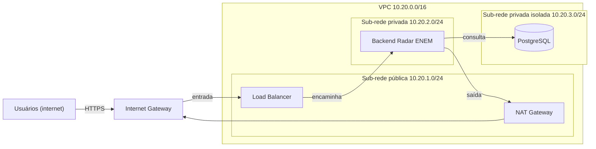

# Aula 11: Redes e Containers com Docker (Mini Radar ENEM)

**Unidade curricular:** Aplicação de Serviços na Nuvem (Computação em Nuvem)
**Tema:** Isolamento de serviços e roteamento hands-on
**Projeto integrador:** Radar ENEM
**Estudante(s) / grupo:** [Nome(s) do(s) integrante(s)]
**Data de entrega:** [Data]

---

## 1. Objetivo

Construir a infraestrutura de rede do Mini Radar ENEM com Docker. O banco de dados fica em uma sub-rede interna, o backend atua como ponte entre duas redes e somente o Nginx Reverse Proxy é exposto ao host.

## 2. Estrutura do projeto

```
Aula11/
├── README.md
└── radar-enem-network/
    ├── docker-compose.yml   # 2 redes e 3 serviços (db-postgres, radar-backend, radar-proxy)
    └── nginx.conf           # Reverse proxy: porta 80 do proxy -> radar-backend:80
```

## 3. Arquitetura de rede (Docker)

| Container | Imagem | Redes | IP | Porta publicada no host |
|---|---|---|---|---|
| `radar-proxy` | nginx:alpine | frontend-net | 172.20.10.10 | 8080 -> 80 |
| `radar-backend` | nginx:alpine | frontend-net, backend-net | 172.20.10.20 e 172.20.20.20 | nenhuma |
| `radar-db` | postgres:15-alpine | backend-net | 172.20.20.50 | nenhuma |

| Rede | Sub-rede | Flag | Função |
|---|---|---|---|
| `radar-enem-network_frontend-net` | 172.20.10.0/24 | bridge (com saída) | Recebe o tráfego do proxy e do backend |
| `radar-enem-network_backend-net` | 172.20.20.0/24 | `internal: true` | Isola o PostgreSQL |

## 4. Como executar

```powershell
# Passo 1 (opcional, o Compose cria as redes sozinho): criar e remover as redes manuais
docker network create --driver bridge --subnet 172.20.10.0/24 frontend-net
docker network create --driver bridge --internal --subnet 172.20.20.0/24 backend-net
docker network rm frontend-net backend-net

# Passo 2: subir o ambiente
cd Aula11\radar-enem-network
docker compose up -d
```

## 5. Resultados

### 5.1 Passo 1: redes manuais

A rede `backend-net` foi criada com `Internal: true` e sub-rede 172.20.20.0/24:

```
Subnet=172.20.20.0/24 Internal=true
```

Depois de inspecionar, as redes manuais foram removidas (`docker network rm`), para que o Compose gerenciasse a topologia.

### 5.2 Passo 2: containers em execução

```
NAME            STATUS         PORTS
radar-backend   Up 6 minutes   80/tcp
radar-db        Up 6 minutes   5432/tcp
radar-proxy     Up 6 minutes   0.0.0.0:8080->80/tcp, [::]:8080->80/tcp
```

Só o `radar-proxy` publica porta no host. O PostgreSQL não tem porta publicada.

### 5.3 Passo 5: testes de conectividade

**Teste 1: acesso externo via proxy** (`curl -i http://localhost:8080`):

```
HTTP/1.1 200 OK
Server: nginx/1.31.8
Content-Type: text/html
X-Proxy-Layer: frontend-net-dmz

{"aplicacao":"Mini Radar ENEM","status":"ONLINE","banco_privado":"172.20.20.50"}
```

**Teste 2: proxy -> banco (esperado falhar)**

```
=== nslookup radar-db (a partir do radar-proxy) ===
Name:	radar-db.sc.senai.br
Address: 10.180.200.132

=== nc -z 172.20.20.50 5432 (a partir do radar-proxy) ===
exit proxy->db: 1
```

A conexão TCP falhou (código 1), como esperado. O `nslookup` não falhou, e isso merece atenção (ver seção 6.1).

**Teste 3: backend -> banco (esperado sucesso)**

```
=== nslookup radar-db (a partir do radar-backend) ===
Name:	radar-db
Address: 172.20.20.50

=== nc -z 172.20.20.50 5432 (a partir do radar-backend) ===
exit backend->db: 0
```

## 6. Desafios de investigação

### Desafio 1: DNS interno do Docker

O proxy resolve `radar-backend` para 172.20.10.20 pelo DNS interno (127.0.0.11). O `/etc/resolv.conf` do proxy mostra que consultas que o DNS interno não conhece são repassadas ao resolvedor do host (`ExtServers: [host(192.168.65.7)]`).

```
Name:	radar-backend
Address: 172.20.10.20
```

Para `radar-db`, o DNS interno não tem registro, porque o container não está em `frontend-net`. A consulta vai ao resolvedor externo. O domínio de busca do host (`sc.senai.br`) transformou o nome em `radar-db.sc.senai.br`, que resolve para 10.180.200.132. Esse endereço pertence à rede externa, não ao container.

**Conclusão:** o DNS não é uma barreira de segurança. O que impede o acesso é a separação de redes: o proxy não tem interface em `backend-net` e não alcança 172.20.20.0/24.

### Desafio 2: múltiplas interfaces e tabela de rotas

```
eth0: 172.20.20.20/24  (backend-net)
eth1: 172.20.10.20/24  (frontend-net)

default via 172.20.10.1 dev eth1
172.20.10.0/24 dev eth1 scope link
172.20.20.0/24 dev eth0 scope link
```

A rota padrão usa `eth1`, da `frontend-net`. A `backend-net` tem `internal: true`, o que impede a saída dela para fora do host. Por isso o Docker não usa a `backend-net` como rota padrão. Ela continua acessível para a rota local 172.20.20.0/24.

### Desafio 3: queda de rota e erro 502

Teste executado com o backend desconectado da `frontend-net`:

```
docker network disconnect radar-enem-network_frontend-net radar-backend
-> HTTP 502

Log do radar-proxy:
connect() failed (113: Host is unreachable) while connecting to upstream,
upstream: "http://172.20.10.20:80/"
```

Restauração sem reiniciar os containers:

```
docker network connect --ip 172.20.10.20 radar-enem-network_frontend-net radar-backend
-> HTTP 200
```

O erro 502 indica que o proxy está ativo, mas o upstream (o backend) não respondeu. O log mostra o IP exato que falhou.

### Desafio 4: acesso administrativo via container efêmero (bastion)

Container temporário na `backend-net` (sem publicar porta no host):

```
docker run --rm --network radar-enem-network_backend-net \
  -e PGPASSWORD=<senha do guia> postgres:15-alpine \
  psql -h 172.20.20.50 -U radar_admin -d radarenem -c "\l"

 postgres  | radar_admin | UTF8 | ...
 radarenem | radar_admin | UTF8 | ...
 template0 | ...
 template1 | ...
```

O administrador acessa o banco sem a porta 5432 exposta no host. A senha foi passada por variável de ambiente porque o terminal usado não tinha TTY (`-it`).

## 7. Relatório técnico (respostas discursivas)

> Rascunho para revisão do grupo.

### 7.1 Isolamento em camadas

O `radar-proxy` não consegue alcançar o `radar-db` por dois motivos. Primeiro, ele só pertence à `frontend-net`, então não tem interface em 172.20.20.0/24. Segundo, a `backend-net` é `internal: true`, e o proxy não é membro dela. O DNS interno não tem registro de `radar-db` para o proxy. Os testes confirmaram isso: a conexão TCP falhou (Teste 2).

Se um invasor comprometesse o Nginx público, ele teria acesso apenas à `frontend-net`. Para chegar ao PostgreSQL, precisaria comprometer o `radar-backend`, que é o único container com interface nas duas redes. Além disso, a porta 5432 não está publicada no host, então o banco não é alcançável pela rede externa, mesmo a partir do host.

### 7.2 Exposição mínima e papel do NAT

Colocar o PostgreSQL em sub-rede pública, com IP alcançável pela internet, viola o princípio da exposição mínima. O banco passaria a receber tentativas de conexão de qualquer origem. A senha forte é a última barreira, e não deve ser a única. Uma falha de software no banco, uma senha vazada ou um ataque de força bruta bastariam para comprometer os dados. Os microdados ficariam acessíveis a quem varresse a internet.

O NAT Gateway permite que recursos em sub-rede privada iniciem conexões de saída. Quando o backend baixa arquivos do INEP, a requisição sai pelo NAT, que traduz o IP privado para o IP público do NAT. A resposta volta pela mesma conexão. Conexões iniciadas da internet não atravessam o NAT, então o backend continua invisível para a internet. O PostgreSQL não precisa de NAT, porque não tem rota de saída.

## 8. Incremento 4: especificação de rede do Radar ENEM (VPC 10.20.0.0/16)

### 8.1 Plano de endereçamento

| Componente / camada | CIDR | IPs totais / úteis | Tipo | Finalidade |
|---|---|---|---|---|
| Entrada / Load Balancer | 10.20.1.0/24 | 256 / 251 | Pública | Recebe tráfego HTTPS dos usuários e hospeda o NAT Gateway |
| Backend Radar ENEM | 10.20.2.0/24 | 256 / 251 | Privada (com saída NAT) | Executa a API e o motor estatístico |
| Persistência PostgreSQL | 10.20.3.0/24 | 256 / 251 | Privada isolada | Armazena dados estruturados e recortes dos microdados |

### 8.2 Tabelas de rotas

| Tabela | Sub-rede | Destino | Próximo salto | Significado |
|---|---|---|---|---|
| Rota pública | 10.20.1.0/24 | 10.20.0.0/16 / 0.0.0.0/0 | Local / Internet Gateway | Tráfego interno e saída para a internet |
| Rota privada (App) | 10.20.2.0/24 | 10.20.0.0/16 / 0.0.0.0/0 | Local / NAT Gateway | Sem entrada externa, com saída para atualizações |
| Rota privada (DB) | 10.20.3.0/24 | 10.20.0.0/16 | Local (sem rota para 0.0.0.0/0) | Banco comunica-se só dentro da VPC |

### 8.3 Diagrama



## 9. Entregáveis do AVA

| # | Entregável | Onde está |
|---|---|---|
| 1 | Inspeção da `backend-net` (CIDR, `Internal: true`, IPs de radar-backend e radar-db) | Seção 5.1 e 4 |
| 2 | Testes de isolamento (proxy, falha proxy -> banco, sucesso backend -> banco) | Seção 5.3 |
| 3 | Desafios 1 a 4 (DNS, rotas, desconexão, bastion) | Seção 6 |
| 4 | Diagrama da VPC 10.20.0.0/16 | Seção 8.3 |
| 5 | Relatório técnico | Seção 7 |

## 10. Limpeza

```powershell
cd Aula11\radar-enem-network
docker compose down
```
